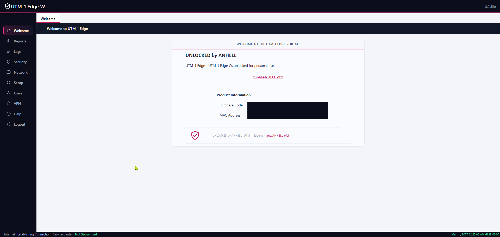
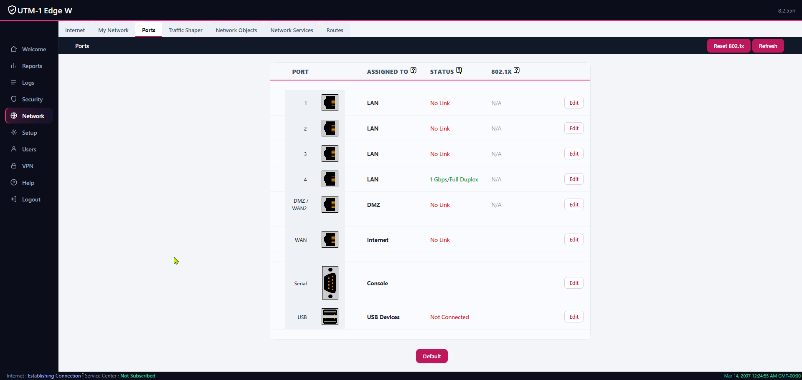
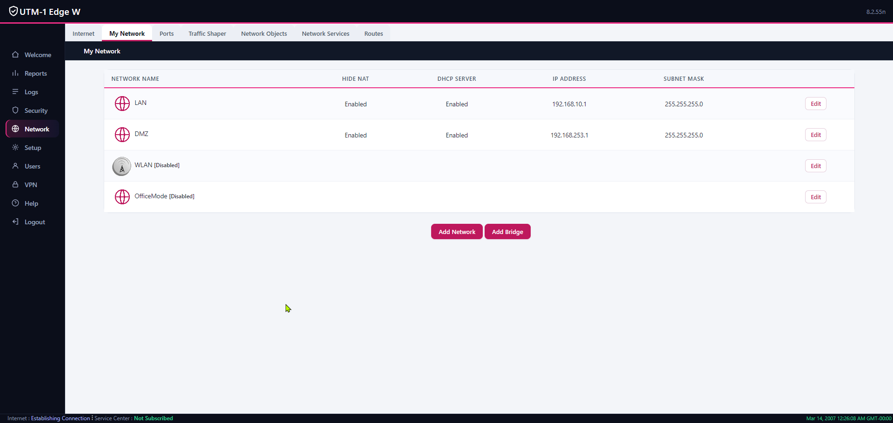
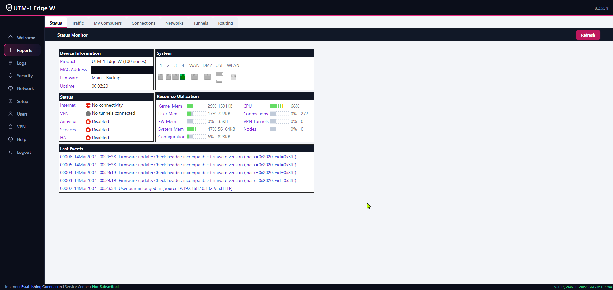

# SBOX4 Edge Unlock

A community **patch-kit** that revives end-of-life **Check Point UTM-1 Edge (W) / SofaWare SBOX4**
appliances: it unlocks the licensed features that can no longer be bought, removes the dead
subscription menus, and reskins the 2007-era web GUI into a clean modern dark/light theme.
Verified on firmware **8.2.55n** (Octeon CN5010, MIPS64 big-endian).

**[English](#english) · [Русский](#русский)**

> This repo ships **only original scripts, CSS and icons** plus instructions — **no Check Point /
> SofaWare code.** You run it against a dump **you** read from **your own** device.
> See [DISCLAIMER.md](DISCLAIMER.md).

| Welcome | Ports |
|---|---|
|  |  |
| **My Network** | **Status** |
|  |  |

 

---

## English

### What it does

- **Unlock** (patch `SofaWare/SafeAtHome`, 3 functions, ~24 bytes):
  - `mv_get_vendor_mask` → `0x3fff` — all vendor features (VPN Server, the "W"/wireless model, …)
  - `sw_is_evaluation_license_expired` → `0` — perpetual evaluation, never expired
  - `sw_var_get_nodes_quota` → `100` — 100-node licence
- **GUI cleanup:** hides the permanently-dead **Antivirus / Antispam / Services** menu items.
- **Branding:** custom welcome text, footer, status-bar line and a link (all configurable).
- **Modern theme:** hybrid dark navigation + light content, flat buttons/tabs, a full flat icon
  set (stock port-connector art kept on purpose), light Ports column, contained traffic graph,
  bigger log font, aligned firewall slider.

Changes are applied by re-packing the squashfs rootfs and recomputing the firmware CRC so the
bootloader accepts the image.

### Requirements

- The device, serial console (UART), and a FAT microSD/USB stick for file transfer.
- A Linux box (WSL works) with: `python3`, `binutils-mips-linux-gnu` (`mips-linux-gnu-objdump`),
  `librsvg2-bin` (`rsvg-convert`), `imagemagick` (`convert`), and `squashfs-tools`:
  **unsquashfs 4.x** to extract, **mksquashfs 3.x** to pack. The 2.6.27 kernel uses squashfs 3.x —
  a 4.x image will **not** boot. Build 3.4 from source:
  ```bash
  make -C squashfs-tools \
    EXTRA_CFLAGS="-fcommon -fgnu89-inline -include sys/sysmacros.h -I." mksquashfs
  export MKSQUASHFS=$PWD/squashfs-tools/mksquashfs
  ```

### Step 1 — root shell
On the Octeon U-Boot prompt (`Ctrl+C` during autoboot → `octeon n200#`), boot Linux with a shell
as init instead of the firmware (append `init=/bin/sh` to the kernel args). You now have a root
shell over serial.

### Step 2 — back up EVERYTHING first
```bash
cat /proc/mtd
mtd_debug read /dev/mtd4 0 <size_mtd4> /mnt/mtd4.bin   # firmware image  (your rollback)
mtd_debug read /dev/mtd5 0 <size_mtd5> /mnt/mtd5.bin   # squashfs rootfs (build input)
md5sum /mnt/mtd4.bin /mnt/mtd5.bin
```
Copy `mtd4.bin` and `mtd5.bin` off the device. **These dumps are your only rollback — keep them.**

### Step 3 — build
```bash
export MKSQUASHFS=/path/to/mksquashfs-3.x
./scripts/build.sh /path/to/dump_dir      # dir with mtd4.bin + mtd5.bin
# -> dump_dir/mtd4.patched.bin (+ prints its md5)
```

### Step 4 — flash & verify
```bash
mount -t vfat /dev/sda1 /mnt              # or sdb1 — check dmesg
md5sum /mnt/mtd4.patched.bin             # must match build.sh output
flash_eraseall /dev/mtd4
mtd_debug write /dev/mtd4 0 <size_mtd4> /mnt/mtd4.patched.bin
mtd_debug read  /dev/mtd4 0 <size_mtd4> /mnt/readback.bin
md5sum /mnt/readback.bin                 # MUST equal the patched md5 BEFORE reboot
```
Only if the read-back matches: `umount /mnt; reboot`. Then open the GUI and **fully clear the
browser image cache** (not just Ctrl+Shift+R). **Rollback:** flash your original `mtd4.bin`.

### The patch, explained
File offset into `SafeAtHome` = `vaddr − 0x10000000`. Each hook is two big-endian MIPS
instructions: `jr ra` (`03e00008`) + `li v0,<value>`:

| Function | vaddr | returns |
|---|---|---|
| `mv_get_vendor_mask` | `0x101b1dd8` | `0x3fff` (`24023fff`) |
| `sw_is_evaluation_license_expired` | `0x100bf41c` | `0` (`24020000`) |
| `sw_var_get_nodes_quota` | `0x101789a8` | `100` (`24020064`) |

**Firmware CRC:** table-driven CRC-CCITT (poly `0x1021`, 32-bit accumulator). The 256-entry table
is in `SafeAtHome` at vaddr `0x1024a950`.
`crc = tab[((crc>>8) ^ byte) & 0xff] ^ ((crc<<8) & 0xffffffff)`, init `0`, over bytes
`[4 : 4+ImageSize+164]` (ImageSize = big-endian u32 at image offset `0x14`), stored big-endian at
offset `0`. The squashfs is spliced in at image offset `0x30fe91`. `build.sh` does all of this.

### Customize branding
```bash
BRAND="UNLOCKED by YOU" TG_LINK="https://t.me/you" TG_LABEL="t.me/you" \
MODEL="UTM-1 Edge W" HELP_URL="https://example.com/help" \
./scripts/build.sh /path/to/dump_dir
```
Theme: [`theme/styles_hybrid.css`](theme/styles_hybrid.css). Icons: `scripts/gen_icons*.sh`.

### Troubleshooting
- **Cold-boot loop after the unit sat powered off** — not firmware: a PSU brownout at the Wi-Fi
  radio power-up ~3 s into boot. Power-cycle to catch a good boot; real fix is a new PSU / recap.
- **Clock shows 2007** — dead RTC coin cell + no NTP. Set it in *Setup → Date & Time* or replace
  the battery.
- **New icons don't show** — browser image cache; clear cached images for "all time".

---

## Русский

Патч-кит, возвращающий к жизни снятые с поддержки **Check Point UTM-1 Edge (W) / SofaWare SBOX4**:
разблокирует лицензируемые функции, которые уже нельзя купить, убирает мёртвые разделы подписок и
перекрашивает GUI 2007 года в современную тёмно-светлую тему. Проверено на прошивке **8.2.55n**
(Octeon CN5010, MIPS64 big-endian).

> В репозитории **только оригинальные скрипты, CSS и иконки** и инструкция — **кода Check Point /
> SofaWare здесь нет.** Ты запускаешь это на дампе, снятом с **твоего собственного** устройства.
> См. [DISCLAIMER.md](DISCLAIMER.md).

### Что делает

- **Разблокировка** (патч `SofaWare/SafeAtHome`, 3 функции, ~24 байта):
  - `mv_get_vendor_mask` → `0x3fff` — все функции вендора (VPN-сервер, модель «W»/Wi-Fi, …)
  - `sw_is_evaluation_license_expired` → `0` — бессрочный eval, не истекает
  - `sw_var_get_nodes_quota` → `100` — лицензия на 100 узлов
- **Чистка GUI:** прячет навсегда мёртвые пункты **Antivirus / Antispam / Services**.
- **Брендинг:** свой текст на главной, в футере и нижней панели, ссылка (всё настраивается).
- **Современная тема:** тёмная навигация + светлый контент, плоские кнопки/вкладки, полный флэт-набор
  иконок (детальные коннекторы портов оставлены стоковыми намеренно), светлая колонка Ports,
  обёрнутый график трафика, крупнее шрифт лога, выровненный слайдер firewall.

Изменения вносятся пересборкой squashfs-rootfs и пересчётом CRC образа, чтобы загрузчик его принял.

### Требования

- Устройство, UART-консоль и FAT microSD/USB для передачи файлов.
- Linux (подойдёт WSL) с: `python3`, `binutils-mips-linux-gnu` (`mips-linux-gnu-objdump`),
  `librsvg2-bin` (`rsvg-convert`), `imagemagick` (`convert`) и `squashfs-tools`:
  **unsquashfs 4.x** для распаковки, **mksquashfs 3.x** для упаковки. Ядро 2.6.27 использует
  squashfs 3.x — образ 4.x **не загрузится**. Сборка 3.4 из исходников:
  ```bash
  make -C squashfs-tools \
    EXTRA_CFLAGS="-fcommon -fgnu89-inline -include sys/sysmacros.h -I." mksquashfs
  export MKSQUASHFS=$PWD/squashfs-tools/mksquashfs
  ```

### Шаг 1 — root-шелл
В U-Boot (`Ctrl+C` при автозагрузке → `octeon n200#`) загрузи Linux с шеллом вместо прошивки
(добавь `init=/bin/sh` в аргументы ядра). Получишь root-шелл по serial.

### Шаг 2 — сначала полный бэкап
```bash
cat /proc/mtd
mtd_debug read /dev/mtd4 0 <size_mtd4> /mnt/mtd4.bin   # образ прошивки (твой откат)
mtd_debug read /dev/mtd5 0 <size_mtd5> /mnt/mtd5.bin   # squashfs rootfs (вход для сборки)
md5sum /mnt/mtd4.bin /mnt/mtd5.bin
```
Скопируй `mtd4.bin` и `mtd5.bin` с устройства. **Эти дампы — единственный путь отката, храни их.**

### Шаг 3 — сборка
```bash
export MKSQUASHFS=/path/to/mksquashfs-3.x
./scripts/build.sh /path/to/dump_dir      # папка с mtd4.bin + mtd5.bin
# -> dump_dir/mtd4.patched.bin (+ выведет md5)
```

### Шаг 4 — прошивка и проверка
```bash
mount -t vfat /dev/sda1 /mnt              # или sdb1 — смотри dmesg
md5sum /mnt/mtd4.patched.bin             # должно совпасть с выводом build.sh
flash_eraseall /dev/mtd4
mtd_debug write /dev/mtd4 0 <size_mtd4> /mnt/mtd4.patched.bin
mtd_debug read  /dev/mtd4 0 <size_mtd4> /mnt/readback.bin
md5sum /mnt/readback.bin                 # ДОЛЖНО совпасть с md5 патча ДО ребута
```
Только если readback совпал: `umount /mnt; reboot`. Затем открой GUI и **полностью очисти кэш
картинок** браузера (не просто Ctrl+Shift+R). **Откат:** прошей исходный `mtd4.bin`.

### Разбор патча
Смещение в файле `SafeAtHome` = `vaddr − 0x10000000`. Каждый хук — две big-endian MIPS-инструкции:
`jr ra` (`03e00008`) + `li v0,<значение>`:

| Функция | vaddr | возвращает |
|---|---|---|
| `mv_get_vendor_mask` | `0x101b1dd8` | `0x3fff` (`24023fff`) |
| `sw_is_evaluation_license_expired` | `0x100bf41c` | `0` (`24020000`) |
| `sw_var_get_nodes_quota` | `0x101789a8` | `100` (`24020064`) |

**CRC образа:** табличный CRC-CCITT (полином `0x1021`, 32-битный аккумулятор). Таблица на 256
записей лежит в `SafeAtHome` по vaddr `0x1024a950`.
`crc = tab[((crc>>8) ^ byte) & 0xff] ^ ((crc<<8) & 0xffffffff)`, init `0`, по байтам
`[4 : 4+ImageSize+164]` (ImageSize = big-endian u32 по смещению `0x14`), пишется big-endian по
смещению `0`. squashfs вставляется по смещению `0x30fe91`. Всё это делает `build.sh`.

### Настройка брендинга
```bash
BRAND="UNLOCKED by YOU" TG_LINK="https://t.me/you" TG_LABEL="t.me/you" \
MODEL="UTM-1 Edge W" HELP_URL="https://example.com/help" \
./scripts/build.sh /path/to/dump_dir
```
Тема: [`theme/styles_hybrid.css`](theme/styles_hybrid.css). Иконки: `scripts/gen_icons*.sh`.

### Решение проблем
- **Бутлуп на холодную после простоя** — не прошивка: просадка питания в пик тока при включении
  Wi-Fi-радио ~через 3 с после старта. Передёрни питание; настоящее лечение — другой БП / рекап.
- **Часы показывают 2007** — села батарейка RTC + нет NTP. Выстави в *Setup → Date & Time* или
  замени батарейку.
- **Новые иконки не видны** — кэш картинок браузера; очисти кэш изображений за «всё время».

---

Not affiliated with Check Point Software Technologies or SofaWare. All trademarks belong to their
owners. Scripts/CSS/icons licensed under [MIT](LICENSE) (the firmware itself is not included).
