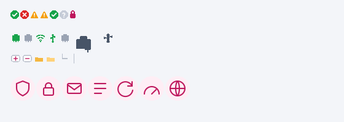
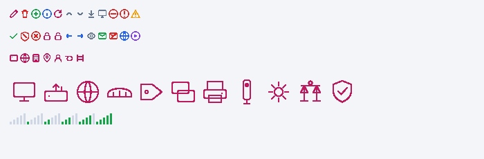

# SBOX4 Edge Unlock

A community **patch-kit** that revives end-of-life **Check Point UTM-1 Edge (W) / SofaWare SBOX4**
appliances: it unlocks the licensed features that can no longer be bought, cuts the dead
subscription menus, and reskins the 2007-era web GUI into a clean modern dark/light theme.

Verified on firmware **8.2.55n** (SofaWare SBOX4, Octeon CN5010, MIPS64 big-endian).

> This repo contains **only original scripts, CSS and icons** plus instructions. It ships
> **no Check Point / SofaWare code**. You run it against a dump **you** read from **your own**
> device. See [DISCLAIMER.md](DISCLAIMER.md).




## What it does

- **Unlock (patch `SofaWare/SafeAtHome`, 3 functions, ~24 bytes):**
  - `mv_get_vendor_mask` → `0x3fff` — enables all vendor features (VPN Server, the "W"/wireless model, …)
  - `sw_is_evaluation_license_expired` → `0` — perpetual evaluation, never expired
  - `sw_var_get_nodes_quota` → `100` — 100-node licence
- **GUI cleanup:** hides the permanently-dead **Antivirus / Antispam / Services** menu items.
- **Branding:** custom welcome text, footer and status-bar line, a Telegram link, and the
  Help item repointed (defaults are jokey — change them, see *Customize*).
- **Modern theme:** hybrid dark navigation + light content, flat buttons/tabs, a full flat
  icon set (stock port-connector art is intentionally kept), light Ports column, contained
  traffic graph, bigger log font, aligned firewall slider.

Everything is applied by re-packing the squashfs rootfs and recomputing the firmware CRC, so
the bootloader accepts the image.

## Requirements

- The device, serial console access (UART), and a microSD/USB stick (FAT) for file transfer.
- A Linux box (WSL works) with:
  - `python3`, `binutils-mips-linux-gnu` (`mips-linux-gnu-objdump`),
    `librsvg2-bin` (`rsvg-convert`), `imagemagick` (`convert`)
  - `squashfs-tools`: **unsquashfs 4.x** to extract, **mksquashfs 3.x** to pack.
    The 2.6.27 kernel on this device uses squashfs 3.x — a 4.x image will **not** boot.
    Build 3.4 from source and point the build at it, e.g.:
    ```bash
    # grab squashfs3.4 sources, then:
    make -C squashfs-tools \
      EXTRA_CFLAGS="-fcommon -fgnu89-inline -include sys/sysmacros.h -I." mksquashfs
    export MKSQUASHFS=$PWD/squashfs-tools/mksquashfs
    ```

## Step 1 — root shell

On the Octeon U-Boot prompt (`Ctrl+C` during autoboot → `octeon n200#`), boot Linux with a
shell as init instead of the firmware, e.g. append `init=/bin/sh` to the kernel args. You now
have a root shell over serial. (Exact commands vary; search the device's U-Boot `printenv`.)

## Step 2 — back up EVERYTHING first

List partitions and dump each one. **Keep these dumps safe — they are your only rollback.**
```bash
cat /proc/mtd
# dump the firmware + rootfs partitions (names/numbers as per /proc/mtd)
mtd_debug read /dev/mtd4 0 <size_mtd4> /mnt/mtd4.bin   # firmware image  (your rollback)
mtd_debug read /dev/mtd5 0 <size_mtd5> /mnt/mtd5.bin   # squashfs rootfs (build input)
md5sum /mnt/mtd4.bin /mnt/mtd5.bin
```
Copy `mtd4.bin` and `mtd5.bin` off the device.

## Step 3 — build the patched image

Put `mtd4.bin` and `mtd5.bin` in one directory, then:
```bash
export MKSQUASHFS=/path/to/mksquashfs-3.x     # see Requirements
./scripts/build.sh /path/to/dump_dir
# -> dump_dir/mtd4.patched.bin  (+ prints its md5)
```

## Step 4 — flash & verify

Copy `mtd4.patched.bin` to a FAT microSD/USB, mount it on the device, then:
```bash
mount -t vfat /dev/sda1 /mnt        # or sdb1 — check dmesg
md5sum /mnt/mtd4.patched.bin        # must match the md5 build.sh printed
flash_eraseall /dev/mtd4
mtd_debug write /dev/mtd4 0 <size_mtd4> /mnt/mtd4.patched.bin
mtd_debug read  /dev/mtd4 0 <size_mtd4> /mnt/readback.bin
md5sum /mnt/readback.bin            # MUST equal the patched md5 before you reboot
```
Only if the read-back matches: `umount /mnt; reboot`.
After boot, open the GUI and **fully clear the browser image cache** (not just Ctrl+Shift+R) —
old cached GIFs otherwise hide the new icons.

**Rollback:** flash your original `mtd4.bin` the same way.

## The patch, explained

File offset into `SafeAtHome` = `vaddr − 0x10000000`. Each hook is two MIPS instructions,
big-endian: `jr ra` (`03e00008`) + `li v0,<value>`:

| Function | vaddr | returns |
|---|---|---|
| `mv_get_vendor_mask` | `0x101b1dd8` | `0x3fff` (`24023fff`) |
| `sw_is_evaluation_license_expired` | `0x100bf41c` | `0` (`24020000`) |
| `sw_var_get_nodes_quota` | `0x101789a8` | `100` (`24020064`) |

**Firmware CRC** (so the loader accepts the image): table-driven CRC-CCITT (poly `0x1021`,
32-bit accumulator). The 256-entry table lives in `SafeAtHome` at vaddr `0x1024a950`.
`crc = tab[((crc>>8) ^ byte) & 0xff] ^ ((crc<<8) & 0xffffffff)`, init `0`, over bytes
`[4 : 4+ImageSize+164]` (ImageSize = big-endian u32 at image offset `0x14`), stored
big-endian at offset `0`. The squashfs is spliced in at image offset `0x30fe91`.
`build.sh` does all of this for you.

## Customize

Branding is env-configurable — put your own name/links:
```bash
BRAND="UNLOCKED by YOU" TG_LINK="https://t.me/you" TG_LABEL="t.me/you" \
MODEL="UTM-1 Edge W" HELP_URL="https://example.com/help" \
./scripts/build.sh /path/to/dump_dir
```
Theme lives in [`theme/styles_hybrid.css`](theme/styles_hybrid.css); icons are generated by
`scripts/gen_icons.sh` and `scripts/gen_icons2.sh` (edit the inline SVGs to taste).

## Troubleshooting

- **Cold-boot loop after the unit sat powered off** — not firmware. It's a PSU brownout at the
  Wi-Fi radio power-up spike ~3 s into SafeAtHome. Power-cycle to catch a good boot; real fix
  is a fresh PSU or recapping the board.
- **Clock shows 2007** — dead RTC coin cell + no NTP (no internet). Set it in *Setup → Date &
  Time*, or replace the battery.
- **New icons don't show after flashing** — browser image cache. Clear cached images for
  "all time", or use a brand-new private window.

## Credits

Reverse-engineering, patches, theme & icons by **ANHELL** · [t.me/ANHELL_ofcl](https://t.me/ANHELL_ofcl).
Not affiliated with Check Point Software Technologies or SofaWare. All trademarks belong to
their owners. Licensed under [MIT](LICENSE) (applies to the scripts/CSS/icons in this repo only).
